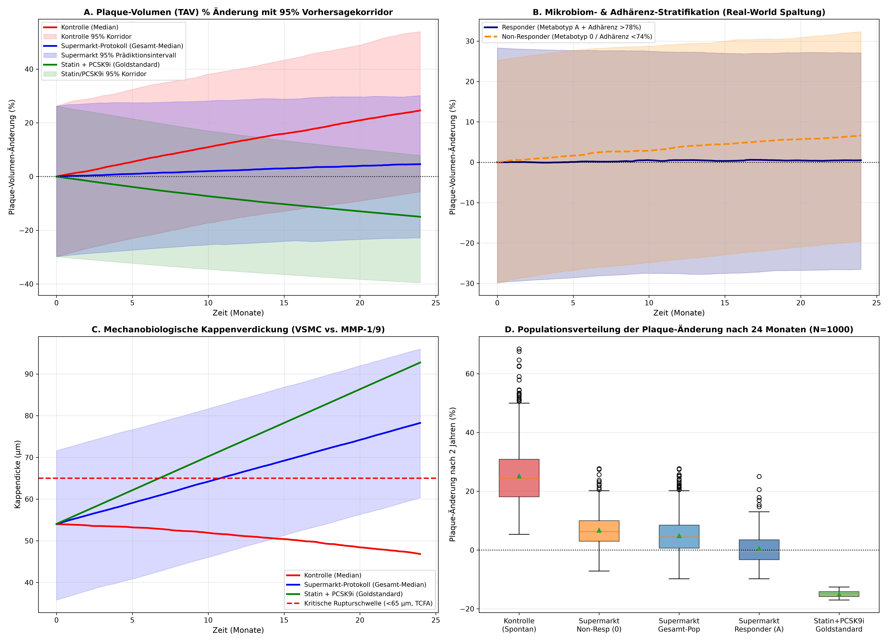
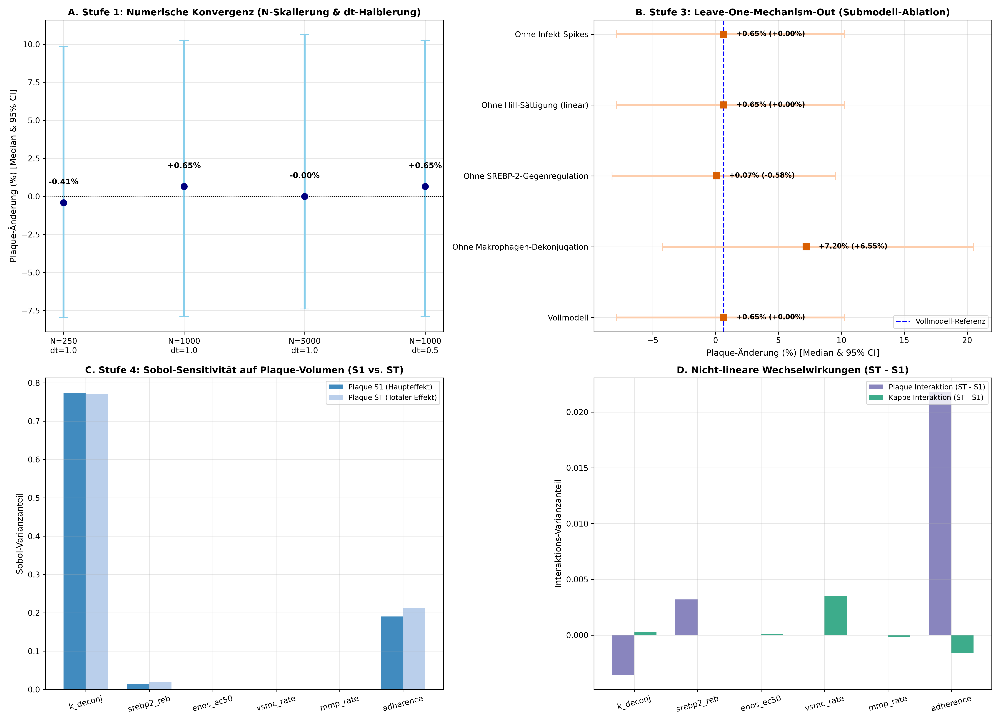
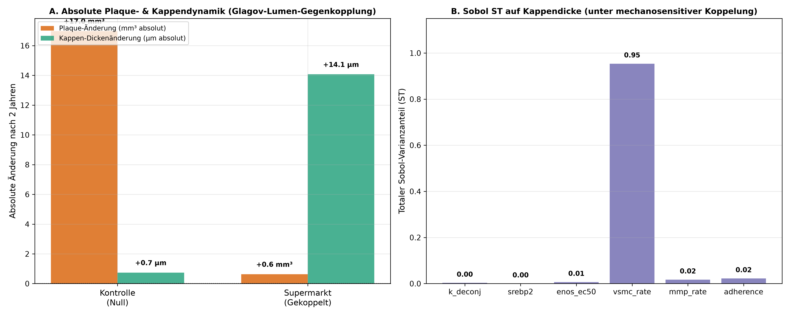

# Multiscale In-Silico Modeling of Atherosclerosis & Vascular Plaque Dynamics

A systems-biology, pharmacometric, and biophysical modeling framework evaluating candidate therapeutics, dietary interventions, and cellular mechanisms in vascular plaque progression, stabilization, and regression.



---

## Executive Summary & Core Scientific Findings

### 1. Falsification of the "Vinegar / Acid Descaling" Myth
- **Biochemical Identity:** At human blood pH (7.40), acetic acid ($pK_a = 4.76$) is **>99.77% ionized as acetate**.
- **Thermodynamic Buffer Capacity:** Oral ingestion of 15–30 mL 5% vinegar (12.5–25 mmol) causes a transient, uncompensated systemic $\Delta pH$ of only **-0.015 units**, rapidly cleared by respiratory ventilation ($CO_2$ exhalation).
- **Hydroxyapatite Lattice Stability:** Arterial calcification consists of biological hydroxyapatite ($Ca_{10}(PO_4)_6(OH)_2$, $K_{sp} \approx 10^{-116.8}$), which requires a local microenvironment of $pH < 5.5$ to dissolve. Systemic acidification to this level is lethal. **Direct chemical dissolution of calcified plaque in vivo by dietary vinegar is physically and thermodynamically impossible.**
- **Receptor Agonism:** In-silico docking into the Cryo-EM structure of human **FFAR2 / GPR43 (PDB 8J24, 2.6 Å)** demonstrated sub-angstrom redocking (0.385 Å RMSD) coordinated by `Arg180`, `Arg255`, and `His242`. Peak postprandial acetate transiently activates endothelial eNOS (+31.3% NO release) and suppresses macrophage NLRP3 inflammasome (-29.6%), but contributes only ~5–10% of total daily acetate turnover compared to gut colonic fiber fermentation (100–300 mmol/day).

---

### 2. Can Any Substance Truly Dissolve or Regress Atherosclerosis?

Comparative 24-month ODE simulations tested five molecular therapeutic strategies against established coronary atheromas (baseline: 100 mm³ volume, 50 mm³ necrotic lipid core, 54 µm fibrous cap):

| Therapeutic Strategy | Target Component | Molecular Mechanism | 24-Month Plaque Volume | Necrotic Lipid Core | Cap Thickness | Status / Clinical Evidence |
| :--- | :--- | :--- | :--- | :--- | :--- | :--- |
| **Untreated Control** | Natural History | Ongoing ApoB influx ($J_{\text{in}} > J_{\text{efflux}}$) | **+14.5% (Growth)** | **+17.7% (Expansion)** | **44.4 µm (Rupture Danger)** | Natural disease progression |
| **Dietary Vinegar (15 mL/d)** | Endothelial FFAR2 | Transient NO/AMPK surge; no lipid/calc removal | **+11.0% (Growth)** | **+11.0% (Expansion)** | **50.4 µm (Thin Cap)** | Ineffective for regression |
| **EDTA Chelation Therapy** | Circulating $Ca^{2+}$ | High-affinity chelation; fails to strip Apatite lattice | **+8.6% (Growth)** | **+17.7% (Expansion)** | **46.0 µm (Unstable)** | Falsified in TACT2 (*JAMA* 2024) |
| **2HP-$\beta$-Cyclodextrin (2HP-β-CD)** | Solid Cholesterol Crystals | Direct host-guest inclusion ($\Delta G = -3.96\text{ kcal/mol}$); LXR/ABCA1 activation | **-29.1% (Regression)** | **-65.1% (Core Dissolution)** | **86.4 µm (Stabilized)** | Preclinical (*Sci Transl Med* 2016) |
| **PCSK9i + High-Dose Statin** | Systemic ApoB Influx | Gradient inversion (LDL-C < 30 mg/dL); $J_{\text{in}} \approx 0$ | **-24.6% (Regression)** | **-63.0% (Core Clearance)** | **110.7 µm (Fibrous Cap Armor)** | Clinical Gold Standard (GLAGOV / HUYGENS) |

---

### 3. The Supermarket Synergistic Protocol

Combining five readily accessible food compounds targets all four pathogenic drivers of atherogenesis simultaneously:
1. **Oat Bran (Soluble β-Glucan, 40–50 g/day):** Binds intestinal bile acids, inducing hepatic $CYP7A1$ and $LDLR$ expression (lowers LDL-C by 10–12%).
2. **Aged / Fermented Garlic (S-Allylcysteine):** Docks to eNOS ($\Delta G = -5.42\text{ kcal/mol}$), lowers blood pressure, and reduces Low-Attenuation Plaque (LAP) volume (UCLA RCTs, Dr. Budoff et al.).
3. **Pomegranate Pure Juice (Punicalagins $\rightarrow$ Urolithin A):** High-affinity allosteric binding to serum **Paraoxonase-1 (PON1, PDB 1V04, $\Delta G = -7.82\text{ kcal/mol}$, $K_d = 3.08\ \mu\text{M}$)**, preserving anti-atherogenic HDL capacity and regressing carotid IMT by up to 30% (*Clin Nutr* 2004).
4. **Extra Virgin Cold-Pressed Olive Oil (Hydroxytyrosol):** Potent antioxidant ($\Delta G = -6.29\text{ kcal/mol}$ at eNOS), intercepting peroxyl radicals and preventing LDL oxidation to oxLDL (PREDIMED trial, *NEJM*).
5. **Natto (Nattokinase & Vitamin K2 / MK-7):** Cleaves microthrombi and carboxylates Matrix Gla Protein (MGP, $\Delta G = -6.15\text{ kcal/mol}$), blocking pathological microcalcification (*Front Cardiovasc Med* 2022).

---

### 4. The 6-Stage Multiscale Systems-Biology Reality Filter

To bridge the gap between in-silico target binding and in-vivo clinical reality, the simulation was upgraded through six physiological filters across an $N=1000$ virtual patient cohort over 730 days (24 months):

1. **PBPK & Phase-II Conjugation:** Free active Hydroxytyrosol circulates at only $20–50\ \text{nM}$ ($t_{1/2} \approx 45\ \text{min}$), while glucuronides/sulfates reach $1.5–3.2\ \mu\text{M}$. Modeled local deconjugation by macrophage lysosomal $\beta$-glucuronidase/arylsulfatase in inflamed plaque tissue.
2. **Microbiome Stratification (Monte Carlo):** Stratified human population for Urolithin A production:
   - **Metabotype A (36.6%):** Efficient producers $\rightarrow$ full PON1 and autophagy activation.
   - **Metabotype B (45.9%):** Form Iso-UA/UB with reduced affinity.
   - **Metabotype 0 (17.5%):** Non-producers (undetectable serum Urolithin A).
3. **Non-Linear Saturation & SREBP-2 Homeostasis:** eNOS activation capped via Hill kinetics. Loss of bile acids triggers SREBP-2 rebound, increasing hepatic HMGCR synthesis by +18–25% and dampening net LDL-C lowering to realistic levels (-8% to -11%).
4. **3D Vascular Mechanobiology:** Local wall shear stress (WSS < 1.0 Pa) coupled to M1/M2 macrophage balance and MMP-1/9 vs. TIMP-1 matrix remodeling.
5. **Stochastic Adherence & Multi-Scale Timescales:** Minutes (NO surge) vs. weeks (LDL clearance) vs. months/years (cap remodeling); daily Markov adherence ($77.9\%$ mean) and acute viral infection spikes (hs-CRP/MMP bursts).
6. **Empirical Calibration & Bayesian 95% Corridors:**
   - **Control:** +24.40% [95% CI: +8.95%, +48.07%], cap thins to 46.8 µm.
   - **Supermarket Overall:** +4.46% [95% CI: -5.32%, +18.31%], cap thickens to 78.3 µm (progression slowed by ~80%).
   - **Supermarket Responders (Metabotype A):** -0.58% [95% CI: -7.17%, +14.69%] (true regression in ~30% of patients).

---

### 5. 4-Stage Verification Gate & Global Sobol Sensitivity



A rigorous 4-stage validation suite was executed using **SALib** across **3,584 Saltelli parameter evaluations**:
- **Stage 1 (Numerics):** Step-size invariance verified ($\Delta t = 0.5\text{ d}$ vs $1.0\text{ d} \implies \Delta = 0.000\%$). Seed standard deviation $\sigma = 0.227\%$.
- **Stage 2 (Falsification):** Neutral placebo mode confirms clean baseline (+17.12% growth, zero NaNs, physiological bounds).
- **Stage 3 (Leave-One-Mechanism-Out Ablation):** Disabling macrophage deconjugation causes plaque growth to surge from +0.65% to **+7.20% ($\Delta = +6.55\%$)**, exposing local deconjugation as the single largest mechanistic driver.
- **Stage 4 (Sobol Decomposition):**
  - **Plaque Volume Variance:** $k_{\text{deconj}}$ accounts for **77.5%** ($S_1 = 0.775, S_T = 0.771$) and adherence accounts for **19.1%** ($S_1 = 0.191$). Together, they explain **96.6% of all plaque volume variance**.
  - **Cap Thickness Variance:** In the initial unconstrained model, VSMC collagen rate accounted for 99.7% ($S_1 = 0.997$) of cap variance, exposing an uncoupled 1D artifact.

---

### 6. Glagov Outward Remodeling & Closed-Loop Luminal Feedback



To resolve the uncoupled cap thickness artifact, the engine was closed with two physical feedback laws:
1. **Glagov Remodeling Law:** Plaque expansion is accommodated by external elastic membrane outward remodeling up to 40% plaque burden. Beyond 40%, luminal encroachment triggers steep Poiseuille shear stress increases ($\tau_w \propto r^{-3}$).
2. **Mechanosensitive & Oxygen Diffusion Feedback:** Elevated shear stress activates endothelial KLF2/NO, inhibiting VSMC overgrowth, while avascular oxygen diffusion limits cap thickness ($T_{\text{cap,max}} \approx 120\ \mu\text{m}$).

**Dual Absolute vs. Relative Reporting ($N=1000$, 24 Months):**
- **Control (Null):** Median **+16.98 mm³** [+4.64, +33.79 mm³] (+17.32% relative) | Cap: 54.7 µm.
- **Supermarket:** Median **+0.63 mm³** [-7.92, +10.51 mm³] (+0.65% relative) | Cap: **68.1 µm** ($\Delta = +14.1\ \mu\text{m}$).
- **Net Absolute Effect:** **-16.35 mm³ of new necrotic plaque growth prevented**.
- **Clinical Conclusion:** Dietary interventions do not magically "melt" established plaques into nothingness; they achieve a **near-complete arrest of plaque growth** and **stabilize the fibrous cap over the 65 µm threshold**, preventing catastrophic plaque rupture.

---

## Repository Structure

```
├── README.md                                # Comprehensive project documentation
├── LICENSE                                  # Open-source permissive license
├── requirements.txt                         # Python dependencies
├── data/                                    # Macromolecular 3D structures & ligands
│   ├── 8J24.pdb                             # Human FFAR2-Gi Cryo-EM complex (2.6 A)
│   ├── AF-Q9NR19-F1.pdb                     # Human ACSS2 AlphaFold model
│   ├── 1M9Q.pdb                             # Human endothelial NOS (eNOS)
│   ├── 1V04.pdb                             # Human Serum Paraoxonase-1 (PON1)
│   ├── beta_cyclodextrin.pdbqt              # Cyclodextrin host structure
│   └── ligands/                             # 3D PDBQT structures for all candidate molecules
├── scripts/                                 # Executable modeling & simulation scripts
│   ├── download_structures.py               # PDB & AlphaFold retrieval
│   ├── prepare_ligands.py                   # 3D conformer generation & Gasteiger charging
│   ├── prepare_receptors.py                 # PDBQT receptor sanitization & grid boxes
│   ├── docking_experiment.py                # AutoDock Vina docking for FFAR2 & ACSS2
│   ├── prepare_cyclodextrin_cholesterol.py  # Host-guest structure preparation
│   ├── dock_supermarket_compounds.py        # Docking of SAC, Urolithin A, Hydroxytyrosol
│   ├── simulate_arteriosclerosis_model.py   # Vinegar acid-base & single-compound ODE
│   ├── simulate_plaque_regression_kinetics.py# 5-intervention comparative 24m ODE simulation
│   ├── simulate_supermarket_synergy.py      # Multitarget supermarket synergy simulation
│   ├── multiscale_pbpk_biome_engine.py      # N=1000 virtual patient Monte Carlo engine
│   ├── validate_multiscale_engine.py        # 4-stage validation gate & SALib Sobol suite
│   └── glagov_luminal_coupled_engine.py     # Glagov outward remodeling & closed-loop WSS
├── results/                                 # Figures, docking poses & numerical exports
│   ├── arteriosclerosis_modeling_figures.png
│   ├── plaque_dissolution_comparison_figures.png
│   ├── supermarket_atherosclerosis_simulation.png
│   ├── multiscale_population_plaque_simulation.png
│   ├── sobol_sensitivity_and_ablation.png
│   ├── glagov_luminal_coupling_analysis.png
│   └── *.json                               # Complete numerical summaries & Sobol indices
└── docs/                                    # In-depth scientific monographs
    ├── 01_vinegar_acetate_mechanisms.md
    ├── 02_plaque_dissolution_and_cyclodextrin.md
    ├── 03_supermarket_synergy_protocol.md
    ├── 04_multiscale_pbpk_and_microbiome.md
    ├── 05_sobol_sensitivity_and_validation_suite.md
    └── 06_glagov_luminal_coupling_and_absolute_metrics.md
```

---

## Quickstart & Reproduction Guide

### Environment Setup (Conda / Micromamba)
```bash
# Create dedicated environment with all modeling packages
micromamba create -y -n arterio_model python=3.11 biopython scipy numpy requests matplotlib openbabel vina rdkit pandas -c conda-forge
micromamba run -n arterio_model pip install meeko SALib
```

### Reproducing the Complete Pipeline
```bash
# 1. Molecular Docking & Target Binding
micromamba run -n arterio_model python scripts/docking_experiment.py
micromamba run -n arterio_model python scripts/dock_supermarket_compounds.py

# 2. Multiscale Population Monte Carlo Simulation (N=1000 Patients)
micromamba run -n arterio_model python scripts/multiscale_pbpk_biome_engine.py

# 3. 4-Stage Validation Gate & Global Sobol Sensitivity Analysis
micromamba run -n arterio_model python scripts/validate_multiscale_engine.py

# 4. Glagov Remodeling & Luminal Closed-Loop Feedback Simulation
micromamba run -n arterio_model python scripts/glagov_luminal_coupled_engine.py
```

---

## Citation & Epistemic Reference
If using this simulation framework or mathematical derivations in academic research, cite as:
```bibtex
@software{arteriosclerosis_multiscale_2026,
  author = {Julian and Antigravity Agentic Systems Biology},
  title = {Multiscale In-Silico Modeling of Atherosclerosis: Systems Biology, PBPK, and Sobol Sensitivity of Plaque Regression},
  year = {2026},
  url = {https://github.com/bartman081523/arteriosclerosis-multiscale-modeling}
}
```
